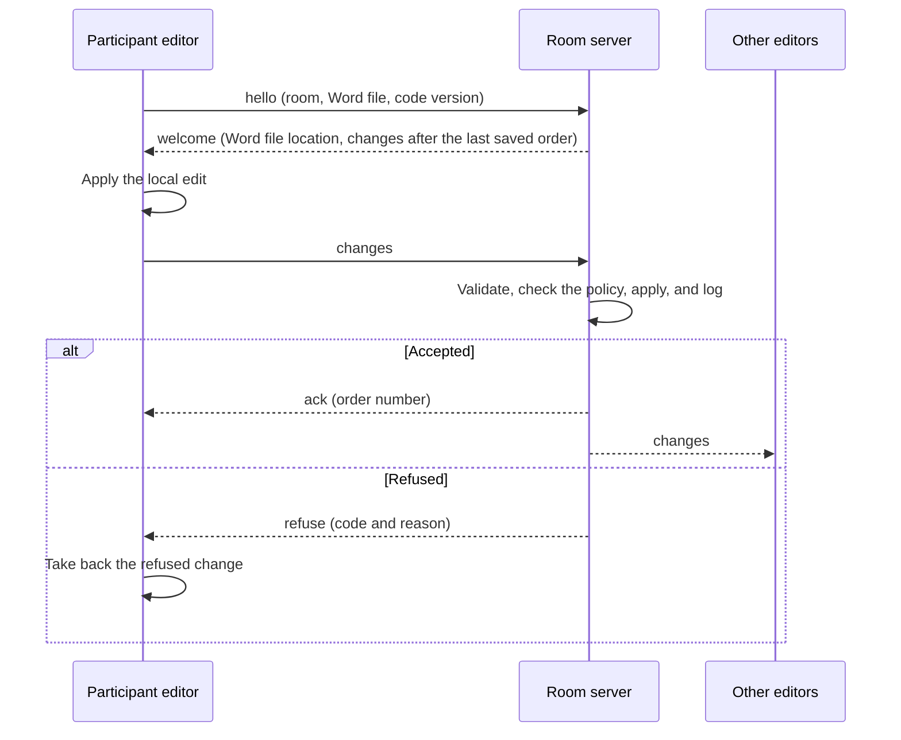

An ordered room is a collaboration room in which a room server puts every change in one order. The server checks each change against a policy before it applies the change. For example, the suggestions-only policy lets some participants add only tracked suggestions, and lets others edit directly and decide.

Use an ordered room when your server must approve each change, such as a review in which some participants may only suggest. For peer-to-peer editing, or a server that only relays updates, use [Yjs collaboration](/docs/2.x/pro/collaboration).

<Callout>
  `@docx-editor.dev/core/collaboration/ordered` is experimental. Its names and shapes can change in
  a minor release.
</Callout>

## How an ordered room works

Each participant's editor holds a copy of the room's document. The editor applies a local edit at once, turns it into changes, and sends them to the room server. The server checks each change, gives it the next order number, and sends it to every participant. Each copy applies the changes in that order, so every copy makes the same document.



A suggestion is a label on items in the document. A decision changes only the status of a suggestion, so a set of decisions gives the same document in every order.

A format change reaches the runs and the paragraph marks that its range covers, as in Word. An equation has no run, so a format change leaves it as it is. A format change whose range holds only equations is accepted and makes no suggestion.

The ordered room has its own change format and message protocol, each at version 1. It does not use Yjs or the [Yjs collaboration format](/docs/2.x/pro/collaboration-versions). An ordered room cannot open a Yjs room, and a Yjs room cannot open an ordered room. To move a document between them, export it to DOCX and open the file in a new room.

## Before you begin

- Install `@docx-editor.dev/core` and `@docx-editor.dev/pro`. The Pro package provides the review and collaboration modules for the editor.
- Run the same `@docx-editor.dev/core` version on every client and on the room server. A copy applies changes the same way only on the same code.
- Provide a WebSocket server and storage for the room's Word file, its change log, and its media.

## Connect an editor to a room

Call `createOrderedCollaboration` with a transport, the room's name, and the code version. It connects, reads the room's Word file, applies the changes after that file, and returns the document and the session.

The following example connects an editor through the browser's WebSocket:

```ts
import {
  createOrderedCollaboration,
  orderedWebSocketTransport,
} from '@docx-editor.dev/core/collaboration/ordered';
import { createDocxEditor } from '@docx-editor.dev/core/editor';
import { collaborationModule, reviewModule } from '@docx-editor.dev/pro';

const handle = await createOrderedCollaboration({
  transport: orderedWebSocketTransport({
    url: 'wss://example.com/rooms',
    socket: (url) => new WebSocket(url),
  }),
  room: 'agreement-42',
  code: CORE_VERSION, // The @docx-editor.dev/core version
  identity: { actorId: user.id, name: user.name },
  person: { id: user.id, name: user.name, org: user.company },
  wordFile: async (location) => fetchBytes(location),
  media: async (location, sha256) => fetchBytes(location + sha256),
  upload: async ({ location, sha256, contentType, bytes, signal }) =>
    storeBytes(location + sha256, contentType, bytes, signal),
  onRefused: (report) => showRefusal(report.code, report.reason),
  onReload: (reason, unsent) => reopenRoom(reason, unsent),
});

const editor = createDocxEditor({
  container,
  document: handle.document,
  author: user.name,
  modules: [reviewModule(), collaborationModule({ session: handle.session })],
});
```

In this example, `CORE_VERSION`, `user`, `fetchBytes`, `storeBytes`, `showRefusal`, and `reopenRoom` are your application's own values and functions.

Pass the person that your login gives the participant as `person`: a stable `id`, the display `name`, and the company `org`, which is an empty string for no company. Give the room server's actor for this login the same person. The session stamps the person on the participant's changes until the room's stamp replaces it. Without `person`, the session uses the identity's `actorId` and `name`, with no company.

The room writes each participant's changes under the Word name `Name (Org)`, or `Name` when `org` is empty. `orderedAuthorName` gives this name. The person ID decides whose a suggestion is: two participants of one company with the same name own only their own suggestions, and one participant in two tabs owns the same suggestions. A suggestion from the uploaded Word file has no person, so it belongs to no participant. No participant can give a suggestion another author: the room refuses that change with the reason `fixed-author`. A change of date stays allowed.

The `wordFile` and `media` callbacks read from the locations that the room server names in `welcome`. The client checks each picture against its SHA-256 hash and content type before it shows the picture. Without `media`, pictures that other participants add show no image.

The room's file can be a Word file or a checkpoint. The client tells them apart by the checkpoint's manifest part. For a checkpoint, the client reads each picture of the file through your `media` callback, as it reads the pictures that participants add, and waits for those reads before the editor's first document. A copy of a picture of the file needs no upload.

The `upload` callback stores a picture that a participant adds, at the location that `welcome` names for media, before any change that shows the picture goes to the room. Return `{ stored: true }` when your storage holds the bytes, or `{ stored: false, code }` when it refuses them. The codes are `blob-too-large`, `blob-hash`, `blob-type`, and `blob-quota`. The client takes back the edits that use a refused picture and reports them with the reason `blob-refused`. If the callback throws or rejects, the client tries again after the reconnect delays and when it connects again. The client aborts `signal` when the session ends.

If a participant may only suggest, open the editor in suggesting mode. The policy refuses a direct edit from that participant. For the editing modes, see [Choose an editing mode](/docs/2.x/pro/tracked-changes#choose-an-editing-mode).

To leave the room, call `editor.destroy()` and then `handle.destroy()`.

### Work with the session

The session implements the editor's collaboration session, and adds these members for your application:

| Member | What it does |
| --- | --- |
| `order()` | Returns the last order number that this copy applied. |
| `unsentChanges()` | Returns this participant's changes that the room has not ordered, also after a reload. |
| `lastRefusal()` | Returns the last refusal that the session reported. |
| `requestDecision(suggestion, status)` | Asks the room to accept or reject the review card that holds the suggestion. |
| `requestDecisions(suggestions, status)` | Asks the room to accept or reject, in one change, every review card that holds one of the suggestions. Use it for **Accept all**, **Reject all**, and any choice of several cards. |
| `addComment(text, from, to)` | Adds a comment thread on a range of the editor. For more information, see [Discussions](#discussions). |
| `addSelectionComment(text)` | Adds a comment thread on the selection that the editor holds. Returns `null` for a caret. |
| `replyToComment(comment, text)` | Replies to the thread of a comment. |
| `resolveComment(comment, note?)` | Resolves the thread of a comment, with an optional last note. |
| `reconnect()` | Connects again at once. |

The editor's own accept, reject, and comment actions also send their changes through the session. The editor's **Accept All** and **Reject All** send one change for every card. Tracked changes to style definitions are cards too, and every editor in the room shows the styles that the decision leaves. If the engine cannot decide a style's change both ways, for example because the change records no author, the change stays in the file, and the session reports it once with the reason `not-in-room`.

A decision names each card as this copy shows it. The room decides each card on its own. If a card changed after this copy showed it, the room leaves that card pending and decides the others. If no card is as this copy showed it, the room refuses the change with the reason `stale-decision`. After the room answers, a requested card whose suggestions are still pending on this copy is a card that the room left. One decision names at most `ORDERED_CHANGE_LIMITS.decisions` suggestions.

To find the pending suggestions that one of the editor's review items names, call `orderedSuggestionsOfRevision` with the item's part, its `w:id`, author, and date. For a change in the styles part, also pass the change element, such as `rPrChange`. The function uses the same index as the editor's own decisions, so two suggestions of one author in one second stay apart.

A card of a tracked change to a style holds one suggestion and no words. To describe it, for example in a log of decisions, read `partRevisions` on the document. It gives the part, the change element, such as `w:pPrChange`, and the style ID.

The following example accepts every card that the copy shows, and counts the cards that the room left:

```ts
import { orderedCards } from '@docx-editor.dev/core/collaboration/ordered';

const session = handle.session;
const requested = orderedCards(session.orderedDocument());
session.requestDecisions(
  requested.map((card) => card.id),
  'accepted'
);

// After the room answers the request:
const pending = new Set(
  orderedCards(session.orderedDocument()).flatMap((card) => card.suggestions)
);
const left = requested.filter((card) => pending.has(card.id)).length;
```

By default, the session keeps edits while the connection is down, and sends them when it connects again. To refuse edits while the connection is down, set `offlineEditing: false`.

### Discussions

A discussion is a Word comment that travels through the room like a suggestion. The room checks each comment with its policy, stamps the participant's person on it, and orders it with the other changes. Every editor in the room shows the comment, and the Word file and the checkpoints keep it.

Use these session members to write comments:

| Member | What it does |
| --- | --- |
| `addComment(text, from, to)` | Adds a comment thread on a range of the editor. If `from` and `to` are one place, the comment has no words. Returns the comment's ID, or `null` when the session takes no edit. |
| `addSelectionComment(text)` | Adds a comment thread on the selection that the editor holds. Returns the comment's ID, or `null` for a caret. |
| `replyToComment(comment, text)` | Replies to the thread of the comment with the ID `comment`. The reply answers the first comment of the thread. Returns the reply's ID, or `null`. |
| `resolveComment(comment, note?)` | Resolves every comment of the thread. If you give a note, the note is the participant's last reply. Returns whether the copy took the change. |

The text is plain text of 1 to 10,000 characters (`ORDERED_CHANGE_LIMITS.comment`). Each line becomes a paragraph of the comment. You cannot edit, delete, or reopen a comment.

The participant's copy shows the comment at once and sends it in the next batch. If the room refuses the comment, the copy takes it back and reports the refusal through `onRefused`. Comments do not enter the undo history.

To comment on the words that the participant selected, keep the selection with `editor.retainSelection()` while the participant writes the comment, and then call `addSelectionComment`. The editor's own **Add comment** action also sends a comment through the session. The editor's reply, resolve, and delete actions are refused; use the session's members instead.

The following example adds a comment and reads the person that the room stamped on it:

```ts
const session = handle.session;
const id = session.addSelectionComment('Why 30 days?\nPlease check clause 4.');
const comment = id === null ? undefined : session.orderedDocument().comments.get(id);

// The person of a room comment; null for a comment of the Word file
const person = comment?.person;
```

The suggestions-only policy applies these rules to every participant:

- Only a participant whose actor has `comments: true` writes comments. Set it only while comments are open.
- A comment cannot be in a header or a footer.
- Only a participant who decides resolves a thread.
- A resolved thread takes no reply and no other resolve.
- A document holds at most 5,000 comments, the Word file's comments included.
- A comment can cover another participant's pending suggestion.

The policy refuses a comment in a header or a footer with the code `policy-furniture`, and every other comment rule with the code `policy-comment` and one of these reasons:

| Reason     | Cause                                                |
| ---------- | ---------------------------------------------------- |
| `comments` | The participant's actor does not give comments.      |
| `resolve`  | A participant who does not decide resolved a thread. |
| `resolved` | The thread is resolved.                              |
| `limit`    | The document holds 5,000 comments.                   |

The room refuses a reply to or a resolve of a comment that the document does not hold with the target code `unknown-comment`.

If a deletion that is not tracked removes every word of a comment, the comment stays at the place of the deleted words. The editor without a room removes such a comment with its words. A tracked deletion keeps the comment on the deleted words.

## Run the room server

The room server holds one `OrderedRoom` for each open room. `OrderedRoom` has no input, output, or timers. Your server reads frames, calls `submit`, stores the result, and sends the answers. Call `submit` for one batch at a time.

The following steps describe the server's tasks:

1. Authenticate each connection, and make an `OrderedActor` from your login data. The actor gives the participant's person (`person`: ID, name, and company) and permissions, including whether the participant may write comments (`comments`). The room stamps that person on each change.
1. Open the room's file under its number: a Word file with `openOrderedWordFile`, or a checkpoint with `openOrderedCheckpoint`. Clients open the same file the same way.
1. Create the room with the document, `applyOrderedChange`, a policy, a clock, the change log after the Word file, and the media that your storage holds.
1. Decode each frame with `decodeOrderedClientMessage`. Treat every frame as untrusted. The decoder enforces the limits in `ORDERED_PROTOCOL_LIMITS`.
1. Answer `hello`. If the room name or the code version does not match, send `reload`. If another person owns the namespace, close the connection. `namespaceOwner` returns the ID of the person who owns a namespace. Otherwise, send `welcome` with the changes from `joinSnapshot`.
1. Pass `changes` and `decide` messages to `submit`. Store the accepted changes in your log first. Then send them to every participant, send the acks and refusals to the sender, and send `saved` when your storage holds them.
1. Check `presence` messages with `admitOrderedPresence` before you send them to other participants.
1. Accept media uploads at the location that you name in `welcome.blobs`. Check the bytes with `isOrderedMediaBytes` and `orderedBlobHash`, and store them under their SHA-256 hash.
1. Check each upload before you store it. Keep the first `ORDERED_MEDIA_PREFIX` bytes while the rest streams to storage, and call `checkOrderedMediaPrefix(prefix, { contentType, size })`. If the answer is `invalid`, refuse the upload with `blob-type`, or with `blob-too-large` when the size is over the cap. If the answer is `whole`, check the stored file with `isOrderedMediaBytes` before you answer.
1. When you make a room from a Word file, store each part that `orderedPackageMedia(base)` lists under its SHA-256, then write the room's first file with `writeOrderedCheckpoint`.

The following example creates a room and handles one batch of changes:

```ts
import {
  OrderedRoom,
  applyOrderedChange,
  encodeOrderedServerMessage,
  openOrderedWordFile,
  suggestionsOnlyPolicy,
} from '@docx-editor.dev/core/collaboration/ordered';

const { document } = openOrderedWordFile(wordFileBytes, { file: 1 });
const room = new OrderedRoom({
  document,
  applyChange: applyOrderedChange,
  policy: suggestionsOnlyPolicy(),
  now: () => Date.now(),
  log: storedChanges, // The changes after this Word file, in order
  blobs: mediaStore, // { has(sha256): boolean }
});

function onChanges(connection, actor, changes) {
  const result = room.submit(actor, changes);
  if (result.accepted.length > 0) {
    appendToLog(result.accepted); // Store before you broadcast
    broadcast({ v: 3, type: 'changes', changes: result.accepted });
  }
  if (result.acks.length > 0) {
    connection.send(encodeOrderedServerMessage({ v: 3, type: 'ack', acks: result.acks }));
  }
  if (result.refused.length > 0) {
    connection.send(
      encodeOrderedServerMessage({
        v: 3,
        type: 'refuse',
        refusals: result.refused,
      })
    );
  }
}
```

In this example, `wordFileBytes`, `storedChanges`, `mediaStore`, `appendToLog`, and `broadcast` are your server's own values and functions.

`submit` handles each change on its own. In order, it validates the batch, answers a change ID that it already applied with its order number, checks that the change's targets exist, asks the policy, and applies the change. If any step fails, the room refuses that change by name, and the document stays as it was. The other changes in the batch continue.

`OrderedLocalRoom` runs the same server role inside one process, for tests and local hosts.

### Restart and close a room

To restart a room, open its file and create `OrderedRoom` with the stored log. If the log does not rebuild the document, the constructor throws `OrderedRoomOpenError` with one of these codes: `log-invalid`, `log-gap`, `log-repeated-id`, `log-stamp`, or `log-apply`.

To close a room, write the document to a checkpoint with `writeOrderedCheckpoint`. A checkpoint holds the parts of the Word file, but names each picture, workbook, and embedded file by its SHA-256 in a manifest part instead of holding its bytes, so a close never writes the pictures again. Give the checkpoint the next file number, and start a new log. A client that joins with an earlier file number receives `reload` with the reason `file`.

The checkpoint's manifest also keeps what the room uses that a Word file has no place for. A room that opens its checkpoint, under any file number, has the same suggestions, cards, and decisions as the room that wrote it, so a checkpoint of one room can be file 1 of a new room:

- Each pending suggestion stays one suggestion, with its person and its ID, even when Word writes it as several changes, such as a replacement or an insertion with a new paragraph. Cards, decisions, and `orderedSuggestionsOfRevision` name the same suggestion IDs before and after a close. A Word file without a manifest gets new suggestion IDs.
- Who typed inside another participant's pending insertion, new row, new note, or new text box stays known. To read it, call `orderedUnitTyper(document, item, offset)`. It returns an `OrderedTyper` for the unit at `offset` of an item that a pending suggestion inserted: the namespace of the change that typed it and that namespace's person, the same before and after a close, or `null`. A room that opens the checkpoint knows the person of each of those namespaces, so `namespaceOwner` answers for them and refuses them to another person.
- A change that Word shows with no change record, such as a control's value or the width a new column takes from its neighbour, keeps its earlier value, so a rejection after a close gives the same file as before it.

An exported Word file holds names only: `writeOrderedPackage`, `orderedPackageBytes`, and `composeOrderedPackage` never write a person ID or any other part of the manifest.

The checkpoint marks the elements that its facts name with attributes of its own namespace, `https://docx-editor.dev/ordered-checkpoint`. Every open removes them before it reads the file, and an uploaded Word file that carries them opens as the same file without them. Each later release opens the checkpoints that an earlier release wrote: a newer manifest only adds sections and fields, and a reader skips the ones it does not know.

When the organiser's suggestion changes formatting or properties that a participant's pending suggestion changed, Word keeps one change record, under the later author. The checkpoint's manifest keeps each record that the later suggestion took over, so the earlier suggestion stays in a reopened room: when the organiser takes the later suggestion back, the earlier change shows again. To name the earlier suggestion on the later suggestion's card, call `orderedReplacedSuggestions(document, suggestion)`. It returns each suggestion whose records the given suggestion holds, with its author, person, date, `formattingKind`, and `formattingChanges`, in the terms of the review queue's items.

To export a Word file, write it with `writeOrderedPackage`. It gives the same bytes as `orderedPackageBytes`. It reads each picture that the checkpoint names, and each picture that the session added, through your `media` function, one at a time, so the server holds at most one picture during the write.

Both writers hand the bytes to your `write` function front to back and wait for each call. If `media` rejects, or gives bytes of another size than the change or the checkpoint named, the writer stops with `OrderedRefusal` and the reason `missing-blob`. Discard the partial file in that case. If the checkpoint's manifest is larger than the engine's limit of one part, 64 MiB, `writeOrderedCheckpoint` stops with the reason `too-many-items`. Discard the partial file, and keep the room's last checkpoint and its log.

The following example writes the room's next file and a Word file to download:

```ts
// The room's next file: no picture bytes are read.
await writeOrderedCheckpoint(room.document, base, {
  media: (sha256) => mediaStore.read(sha256),
  // Send the next bytes to storage, for example one part of a multipart upload.
  write: (chunk) => checkpointUpload.write(chunk),
});

// A Word file to download: every picture is read from storage.
await writeOrderedPackage(room.document, base, {
  media: (sha256) => mediaStore.read(sha256),
  write: (chunk) => exportUpload.write(chunk),
});
```

In this example, `base` is the package that `openOrderedWordFile` or `openOrderedCheckpoint` returned, and `mediaStore`, `checkpointUpload`, and `exportUpload` are your server's own objects. `writeOrderedCheckpoint` reads `media` only for an ink part that the session added.

To write a Word file without comments, for example a final copy that keeps only the document and its tracked changes, pass `comments: 'remove'` to `writeOrderedPackage`, `orderedPackageBytes`, or `composeOrderedPackage`. The file then has no comment in any part. The body, headers, footers, notes, and text boxes lose their comment ranges and references. The comments part, the parts that hold comment threads and IDs, and any part that only those parts name, in turn, leave the file with their relationships and content types. For example, a picture that only a comment shows leaves the file, and so does the workbook of a chart in a comment. The room's comments are not written either. Tracked changes, the people part, and every other part stay as the default, `comments: 'keep'`, writes them.

The option does not change the document, so you can write both files from one document, in either order. The following example writes a copy with comments and a final file without them:

```ts
// The copy with comments.
await writeOrderedPackage(room.document, base, {
  media: (sha256) => mediaStore.read(sha256),
  write: (chunk) => copyUpload.write(chunk),
});

// The final file: the same document, without comments.
await writeOrderedPackage(room.document, base, {
  media: (sha256) => mediaStore.read(sha256),
  write: (chunk) => finalUpload.write(chunk),
  comments: 'remove',
});
```

If a comment part cannot leave the file, because the file keeps the relationships of the part that names it only as bytes, the writer throws `OrderedRefusal` with the reason `engine-refused` before it writes any bytes. A checkpoint always keeps the comments, because it is the room's own file.

## Choose a policy

A policy gives a verdict for each change before the room applies it. A policy reads only the change and the items that it touches, so a check costs only what the change covers.

| Policy | Who may do what |
| --- | --- |
| `suggestionsOnlyPolicy()` | Participants whose actor has `suggests: true` add tracked suggestions, change or take back their own pending suggestions, and write comments. Other participants edit directly and suggest anywhere. Of those, participants whose actor has `decides: true` also accept and reject suggestions. |
| `allowWritersPolicy` | Every participant who is not read-only may make any change. Use it for tests and trusted hosts. |
| Your own `OrderedRoomPolicy` | Your `check` function returns `{ ok: true }`, or a refusal with an `OrderedPolicyCode`. |

Under the suggestions-only policy, a participant who may only suggest cannot:

- Change a header or a footer.
- Edit inside another participant's pending suggestion: type or delete in their inserted words, type in a row, a cell, a table, a note, a text box, a content control, or a link that they inserted, or format their inserted or deleted words.
- Make a direct edit.
- Accept or reject a suggestion.
- Add to or take back another participant's suggestion.

Typing at the start or the end of another participant's new link or content control is allowed, because the words go beside it, as in the editor alone. If the keyboard types inside a content control at its edge, the words go in the control, and the policy refuses them. A format on another participant's inserted or deleted words is refused, because Word records it inside their suggestion. A format that their words have already is allowed, because it records nothing. A property change on their paragraph, row, cell, or table is allowed. It is a suggestion of its own, as Word records it beside their suggestion. A direct edit, or an edit in a header or a footer, that changes nothing is allowed, such as a format that the words have already.

No participant can add to or take back another participant's suggestion, because the change would be written under that participant's name. A content control's lock binds every participant.

The comment rules apply to every participant. For more information, see [Discussions](#discussions).

## Handle refusals

Every refusal has a stable code and, where one applies, a stable reason. Branch on the code and the reason, and show the detail only in logs.

The client reports refusals through `onRefused` with one of these codes:

| Code | Meaning |
| --- | --- |
| `ordered-unsupported-op` | The edit holds an operation that the change format does not express. `reason` names the operation. |
| `ordered-opaque-write` | The editor made a write that the session cannot see. |
| `ordered-refused` | The document, the room, or the client refused the edit. `reason` names the cause. |

When changes from the room arrive, or when the session connects again, the client applies the participant's pending changes again on top of them. If a pending change no longer applies, the client takes it back and reports it with the reason `pending-refused`. If it fails for another cause, such as an engine defect, the client takes it back and reports it with the reason `apply-failed`. The detail names the error type. The changes that need it are refused too. The client sends the other pending changes, and the session stays ready. To log the error itself, pass `onApplyError`:

```ts
const handle = await createOrderedCollaboration({
  // The other options, as in "Connect an editor to a room"
  onApplyError: (error, change) => logDefect(error, change.id),
});
```

If a new picture is larger than the room's media limit for its type, the client refuses the edit before the editor applies it. The reason is `media-too-large`, and the detail is the content type. You can tell the participant that the picture is too large to add. If the bytes are not an image that the room stores, the reason is `invalid-media`. For the limits, see [Media limits](#media-limits).

If your `upload` callback refuses a picture, the client takes back the edits that use it and reports each one with the reason `blob-refused`. The detail is the refusal code.

If the client cannot show the room's document in the editor, the session status changes to `error` with the code `remote-apply-failed`. The session returns to `ready` when a later update shows. You can still close the editor and the session.

The room refuses a change with an `OrderedRoomRefusalCode`:

| Code | Meaning |
| --- | --- |
| A validator code | The batch is malformed. The whole batch is refused. |
| A target code | An address, story, or suggestion is not in the document, or a range runs backward. |
| `stamp` | Another participant owns the sender's namespace. |
| `missing-blob` | The change names media that the room's storage does not hold. |
| A policy code | The policy refused the change. |
| `apply-refused` | The document model refused the change. `reason` gives the `OrderedRefusalReason`. |
| `apply-failed` | Applying the change failed for another cause. The room took the change back. |

The policy codes are `policy-read-only`, `policy-decide`, `policy-furniture`, `policy-nested`, `policy-direct`, `policy-not-own`, `policy-comment`, and `policy-failed`. The suggestions-only policy can also give an `OrderedPolicyReason`, such as `furniture`, `nested`, or `others_suggestions`, which your application can report in its own messages.

A policy gives its verdict before the room applies a change. It can also implement `checkApplied`, which judges what the change did once it applied, and the room takes the change back if `checkApplied` refuses it. The suggestions-only policy uses it for three rules. A party's direct edit, or a party's change in a header or footer, is accepted only when it makes no suggestion. A direct edit that types inside a pending insertion makes no suggestion of its own, because it joins that insertion, so the policy refuses it before it applies. A party's format is nested when it records a change in another person's inserted or deleted words. A party's format or property change may not take over another person's pending record. If your `applyChange` wraps `applyOrderedChange`, pass the room's context on unchanged so that the room learns what the change did. If the room does not learn it, a policy with `checkApplied` refuses the change with `policy-failed`.

The room sends `reload` when a client must open the room again. The reason is one of these values:

| Reason     | Cause                                                                |
| ---------- | -------------------------------------------------------------------- |
| `version`  | The client's protocol or code version is not the room's version.     |
| `file`     | The room moved to another Word file.                                 |
| `protocol` | The client sent a frame that the room cannot read.                   |
| `closed`   | The room closed.                                                     |
| `writer`   | Another server process took the room.                                |
| `slow`     | The client read messages too slowly, and the room stopped its queue. |

After a reload, `onReload` receives the reason and the participant's unsent changes. Open the room again with a new session. Show the unsent changes to the participant, because the new session does not send them for you.

If a room's file is not a checkpoint of this engine's format and version, `openOrderedCheckpoint` throws `OrderedWordFileError` with the reason `not-checkpoint`, `checkpoint-format`, `checkpoint-version`, or `checkpoint-manifest`. A manifest whose suggestions, persons, takeovers, typers, labels, or kept values do not match the file gives `checkpoint-manifest`. `openOrderedWordFile` refuses a checkpoint with the reason `checkpoint`.

## Limits

An ordered room refuses some edits that Word also refuses, and some that the room does not express:

- Typing in the result of a table of contents is refused. Update the table of contents instead.
- Pasting paragraphs inside a link's text is refused.
- A pasted picture that names its image only by a web or file address is refused with `external-picture-link`. A picture that also embeds its image keeps the image, and the room drops the address.
- A suggestion of a change that Word cannot track, such as a picture's size or position, is refused with `untracked-only`. Make the change as a direct edit.

The protocol limits frame sizes, the number of changes in one frame, and the size of presence data. For the values, see `ORDERED_PROTOCOL_LIMITS`. The change format limits each change. For the values, see `ORDERED_CHANGE_LIMITS`.

### Media limits

A media file is at most 25 MiB (`ORDERED_RESOURCE_LIMITS.mediaSize`). An SVG file is at most 2 MiB (`ORDERED_RESOURCE_LIMITS.svgSize`), because the client parses it whole. A change that names larger media is refused. A client refuses a new picture over its limit with the reason `media-too-large`.

`checkOrderedMediaPrefix` answers from the first bytes of a file:

- `valid`: the whole file passes `isOrderedMediaBytes`.
- `invalid`: the whole file fails it.
- `whole`: only the whole file can decide. An SVG, a JPEG whose frame header lies past the first bytes, and a TIFF whose first image directory lies past them give this answer.
